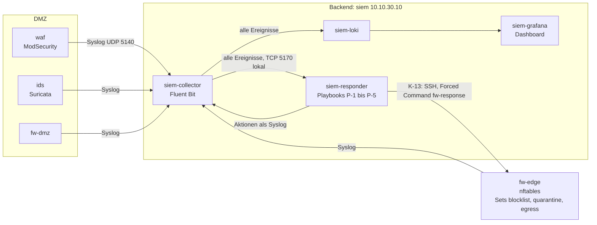

# Reaktive Maßnahmen – DMZ-Laborumgebung

Stand: 2026-11-06, Version 0.2 (Befunde des Reviews vom 2026-11-06 eingearbeitet). Anforderungen A-06 (reaktive Maßnahme), A-07 (Messung), SEC-04, Verbindung K-13.

## Ziel

Die Aufgabenstellung verlangt neben proaktiven auch reaktive und detektierende Maßnahmen. Die Vorlesung (Kapitel 1, Folien 1-59 und 1-66) beschreibt reaktive Maßnahmen als Maßnahmen, die nach dem Erkennen eines Angriffs greifen. Sie sollen den Angriff eindämmen, Schäden begrenzen, Ursachen beseitigen und den sicheren Betrieb wiederherstellen. Laut Vorlesung erfolgt die Reaktion „je nach Maßnahme automatisch oder durch verantwortliche Personen nach festgelegten Abläufen“.

Die Umsetzung folgt genau dieser Aufteilung:

| Maßnahme nach Vorlesung | Hier umgesetzt | Art | Nachweis |
|---|---|---|---|
| Zugriffe unterbinden, verdächtige Verbindungen beenden | Sperre der Quelle an `fw-edge`, Löschen ihrer Verbindungen im Conntrack | automatisch (P-1, P-2, P-3) | RE-03, RE-04, RE-05, RE-08, A-1, A-2 |
| Ausbreitung verhindern, infiziertes Endgerät isolieren | Quarantäne eines internen Hosts, unbefristet bis zur Freigabe | automatisch (P-4), Freigabe manuell | RE-06, A-3 |
| Kommunikation mit dem Angreifer unterbinden | Sperre aller Verbindungen von innen zum Ziel einer verbotenen Verbindung aus der DMZ (Command and Control) | automatisch (P-5) | RE-07, RE-16, A-4 |
| Beweise sichern | `make evidence`: Ereignisse aus dem SIEM, Regelwerke mit Zählern, Verbindungen, Container-Logs, Integrität gegen das Image, SHA-256 | manuell nach Ablauf | Abschnitt Ablauf |
| Sicheren Betrieb wiederherstellen, Schwachstelle schließen | `make recover`: alle Systeme aus den Images neu aufsetzen, Anwendung im sicheren Modus, Sperren bleiben bestehen | manuell nach Ablauf | Abschnitt Ablauf |
| Sperren durch das SOC | `make block`, `make quarantine`, `make release`, `make response-mode` | manuell | RE-02, RE-12 |

## Aufbau

Ablauf einer automatischen Sperre:

1. Ein Sensor meldet ein Ereignis an das SIEM, etwa die WAF einen geblockten Angriff.
2. Fluent Bit zerlegt die Meldung in Felder (E-14) und gibt sie an Loki und gleichzeitig an den Responder.
3. Der Responder prüft, ob die Meldung vom richtigen Sensor stammt (Absenderadresse, siehe „Schutz vor Fehlsperren“), ordnet das Ereignis einem Playbook zu und zählt es im Zeitfenster der Quelle.
4. Ist die Schwelle erreicht, schickt er über die stehende SSH-Verbindung eine Zeile wie `block 192.0.2.10 600 P-1` an `fw-edge`.
5. `fw-response` auf `fw-edge` prüft die Zeile, trägt die Adresse mit Ablaufzeit in das nftables-Set ein und löscht ihre Verbindungen aus dem Conntrack.
6. Ab dem nächsten Paket verwirft `fw-edge` jeden Verkehr von und zu der Adresse. Die Firewall meldet die verworfenen Pakete an das SIEM.
7. Der Responder meldet die Aktion mit Reaktionszeit an das SIEM. Das Dashboard zeigt sie im Feld „Reaktionen“ und als Markierung im Verlauf.

## Playbooks

Die Playbooks stehen als Daten in `configs/response/playbook.json`. Schwellen und Fenster lassen sich dort ändern, ohne den Code anzufassen.

| ID | Auslöser | Schwelle | Maßnahme | Begründung |
|---|---|---|---|---|
| P-1 | WAF blockt eine Anfrage (`Access denied`) | 3 in 60 s je Quelle | Sperre 10 min, interne Quelle: Quarantäne | Ein einzelner Fehlalarm der WAF sperrt keinen Nutzer. Drei Blocks in einer Minute sind ein Angriff oder ein Werkzeug. |
| P-2 | IDS-Alarm auf der Strecke `waf` → `web` | 1 | Sperre 10 min | Der Alarm hinter der WAF heißt: Die Anfrage ist an der WAF vorbeigekommen. Höchste Dringlichkeit, keine Wartezeit. |
| P-3 | Verworfene Pakete einer externen Quelle an `fw-edge` oder `fw-dmz` | 10 verschiedene Zielports in 20 s | Sperre 10 min | Typisches Muster eines Portscans. Ein gezielter, langsamer Scan (A-1 Stufe 1, 7 Ports) bleibt bewusst darunter und wird nur gemeldet. |
| P-4 | Verworfene Pakete einer internen Quelle (Client-Netz, VPN) an interne Ziele | 3 verschiedene Ziel-Hosts in 60 s, mehrere Ports desselben Hosts zählen einmal | Quarantäne bis zur Freigabe | Seitwärtsbewegung eines kompromittierten Arbeitsplatzes. Ein isolierter Host bleibt isoliert, bis ihn jemand geprüft hat. |
| P-5 | IDS-Alarm aus der DMZ nach außen mit SID 1000003 (Verbindungsaufbau auf einem nicht freigegebenen Port) oder SID 1000007 (Ausgabe eines Shell-Befehls, z. B. `uid=… gid=…`) | 1 | Verbindungen von innen zum Ziel 10 min sperren (`egress`) | Ein Server, der eine Reverse Shell aufbauen will, ist vermutlich kompromittiert. Die Gegenstelle wird auch für TCP 80 und 443 gesperrt, die K-06 sonst erlaubt, und zwar für das ganze Firmennetz. Verbindungen, die die Gegenstelle selbst aufbaut, bleiben erlaubt. Sonst könnte ein kompromittierter Server mit einem einzigen Paket beliebige Adressen vom Portal aussperren. |

Weitere Regeln:

- P-5 reagiert nur auf die Signaturen in `sids` (`playbook.json`). Eine neue IDS-Regel ändert das Verhalten von P-5 also nicht unbemerkt (RE-16).
- Sensorbindung: Meldungen mit `ident` `ulogd` nimmt der Responder nur von `fw-edge` 10.10.0.9 und `fw-dmz` 10.10.0.2 an, `suricata` nur von `ids` 10.10.10.14, `modsecurity` nur von `waf` 10.10.10.6 (`sensors` in `playbook.json`, Absender aus `src_addr` von Fluent Bit). Alles andere zählt er als `rejected` und meldet es höchstens alle 10 s an das SIEM (RE-15).

- Wiederholungstäter: Jede weitere automatische Sperre derselben Adresse innerhalb von 24 h dauert doppelt so lang, höchstens 24 h.
- Während eine Adresse gesperrt ist, zählt der Responder ihre Ereignisse nicht weiter.
- Meldungen über bereits gesperrte Pakete (`block drop`, `quarantine drop`) und über gefälschte Absender (`spoof drop`) lösen nichts aus.
- Höchstens 30 automatische Aktionen pro Minute. Darüber meldet der Responder `suppressed` und sperrt nicht weiter. Das verhindert, dass eine Flut gefälschter Ereignisse die Sperrliste füllt.
- Beobachtungsmodus (`monitor`): Der Responder entscheidet wie sonst, meldet aber nur `would_block` oder `would_quarantine`. Die Tests der einzelnen Schichten laufen in diesem Modus (`tests/lib-response.sh`), damit ihre Angriffe den Angreifer nicht für den nächsten Test aussperren.

## Durchsetzung an `fw-edge`

`configs/fw-edge/nftables.nft`, Tabelle `inet response`:

| Element | Aufgabe |
|---|---|
| Set `blocklist` | Gesperrte Adressen mit Ablaufzeit, höchstens 4096 |
| Set `quarantine` | Isolierte interne Hosts, ohne oder mit Ablaufzeit, höchstens 256 |
| Set `egress` | Ziele, zu denen von innen keine Verbindung mehr aufgebaut werden darf (P-5), mit Ablaufzeit, höchstens 1024 |
| Set `protected` | Adressen, die nie gesperrt werden: Transfernetze, DMZ, Backend, das Gateway des Client-Netzes 10.10.20.1, eigene Adresse, die beiden VPN-Gegenstellen |
| Kette `prerouting`, Priorität `raw + 10` | Verwirft Pakete mit gesperrter Quelle oder gesperrtem Ziel (`blocklist`, `quarantine`) |
| Kette `forward`, Priorität `filter - 10` | Verwirft Pakete in Richtung eines `egress`-Ziels, aber nur in Verbindungen, die von innen aufgebaut wurden (`ct direction original`). Antworten auf Verbindungen der Gegenstelle laufen weiter. |
| Ketten `blocked`, `quarantined` | Zählen und melden die verworfenen Pakete gedrosselt an das SIEM |

Gründe für diese Form:

- `fw-edge` ist der einzige Punkt, über den Internet, VPN, Client-Netz, DMZ und Backend miteinander sprechen. Eine Sperre dort wirkt für alle Wege.
- Die Prüfung läuft vor Conntrack und vor der Adressumsetzung. Gesperrte Pakete erzeugen keinen Zustand und belasten die Verbindungstabelle nicht. Bestehende Verbindungen laufen sofort ins Leere, `fw-response` löscht sie zusätzlich aus dem Conntrack.
- `blocklist` greift für Quelle und Ziel und sperrt einen Angreifer vollständig. `egress` sperrt nur den Verbindungsaufbau von innen, also den Weg zu einem Command-and-Control-Server. Die Unterscheidung kam aus einem externen Review (2026-11-05). Vorher hätte P-5 jede Gegenstelle vollständig gesperrt.
- Die Ablaufzeit verwaltet der Kernel. Fällt das SIEM aus, bleiben die Sperren bestehen und laufen trotzdem pünktlich ab.
- `flush ruleset` beim Neuladen des Regelwerks leert die Sets. Der Responder gleicht seinen Stand alle 30 s mit `fw-edge` ab.

## Kanal K-13: SIEM → `fw-edge`

| Punkt | Umsetzung |
|---|---|
| Protokoll | SSH, eine dauerhafte Sitzung des Responders, Befehle zeilenweise |
| Weg | `siem` 10.10.30.10 → `fw-backend` → `fw-edge` 10.10.0.9 TCP 22. `fw-backend` lässt nur diese eine Verbindung hinaus, `fw-edge` nimmt sie nur auf `eth4` an. `sshd` lauscht nur auf 10.10.0.9. |
| Verfahren | BSI TR-02102-4: Schlüsseleinigung `ecdh-sha2-nistp384`, Server und Client mit ECDSA P-384, Verschlüsselung AES-256-GCM. Andere Verfahren lehnt `sshd` ab (RE-01). |
| Anmeldung | Nur öffentlicher Schlüssel, nur `root@10.10.30.10`. `authorized_keys` mit `restrict`, `from="10.10.30.10"` und `command=`. Passwörter, Weiterleitungen, Terminal und Umgebungsvariablen sind abgeschaltet. |
| Befehle | `ForceCommand`: Jede Sitzung startet `fw-response`. Erlaubt sind nur `ping`, `block`, `quarantine`, `egress`, `release`, `list`, `flush`, `stats`. Eine Shell gibt es nicht (RE-01). |
| Prüfung auf `fw-edge` | `fw-response` prüft Adresse, Dauer und Grund streng und verweigert geschützte Adressen selbst (RE-02). Ein kompromittiertes SIEM kann damit weder eine Shell auf der Firewall öffnen noch DMZ oder Backend sperren. |
| Schlüssel | `make pki` erzeugt sie in `configs/response/keys/`, nicht im Repo. Der Responder kennt den Host-Schlüssel von `fw-edge` vorab (`StrictHostKeyChecking=yes`). |
| Protokoll der Firewall | `sshd` und `fw-response` melden jede Anmeldung und jede Änderung über Syslog an das SIEM (`ident` `sshd-session`, `fw-response`). |

Erwogene Alternativen:

- Grafana-Alerting mit Webhook: Standardweg, aber die Regeln werden frühestens alle 10 s ausgewertet. Für eine Reaktion in unter 1 s zu langsam.
- Firewall holt eine Sperrliste ab (Pull, wie External Dynamic Lists): kein lauschender Dienst auf der Firewall, aber die Reaktionszeit hängt vom Abrufintervall ab. Bleibt eine mögliche Verbesserung.
- Eigene HTTP-Schnittstelle auf der Firewall: mehr eigener Code an der empfindlichsten Stelle, Authentisierung selbst gebaut.

SSH mit Forced Command ist verbreitet, gut geprüft und lässt sich nach BSI TR-02102-4 konfigurieren.

## Schutz vor Fehlsperren

Eine automatische Sperre ist selbst ein Angriffsziel. Wer das System dazu bringt, Unbeteiligte zu sperren, erreicht eine Dienstverweigerung. Gegenmaßnahmen:

| Gefahr | Gegenmaßnahme | Nachweis |
|---|---|---|
| Gefälschter Absender aus dem Internet, z. B. die Adresse eines internen Clients | Anti-Spoofing in `fw-edge`: Jede Schnittstelle nimmt nur die Absender ihres Netzes an. Das Internet liefert keine internen oder reservierten Adressen, außer im VPN-Tunnel. | RE-10 |
| Gefälschter `X-Forwarded-For` vor dem Proxy | Der Collector übernimmt `xff` nur von Alarmen hinter dem Proxy (Absender `proxy` oder `waf`), sonst gilt `src_ip`. Der Proxy überschreibt den Header ohnehin. | RE-09 |
| Sperre eigener Systeme oder der VPN-Gegenstellen | Schutzliste dreifach: im Responder, in `fw-response` und als Regel im Regelwerk | RE-02 |
| Einzelne Fehlalarme | Schwellen und Zeitfenster, automatische Aufhebung nach Ablauf | RE-12 |
| Flut von Ereignissen | Höchstens 30 Aktionen pro Minute, Set-Größen begrenzt | Code, `max_actions_per_minute` |
| Fehlbedienung | Beobachtungsmodus, Freigabe jederzeit, Verlauf aller Aktionen | RE-11 |
| Ein kompromittierter DMZ-Server löst P-5 gegen beliebige Adressen aus | P-5 sperrt nur Verbindungen von innen (`egress`), die Adresse erreicht das Portal weiter | RE-07 |
| Ein Client fälscht die Adresse seines Gateways | 10.10.20.1 steht in der Schutzliste, `router-int` verwirft Pakete mit eigener Adresse als Absender ohnehin | RE-02 |
| Ein kompromittierter Sensor gibt sich als anderer aus, z. B. die WAF als Firewall, und meldet Seitwärtsbewegungen von `client1` | Sensorbindung im Responder, Fluent Bit setzt `host` nach der Absenderadresse, `fw-dmz` verwirft gefälschte DMZ-Absender | RE-15, H-11 |
| Gefälschte öffentliche Absender aus dem Internet lösen P-3 gegen Unbeteiligte aus (einzelne SYN-Pakete genügen, das Anti-Spoofing kennt nur interne und reservierte Adressen) | Nur begrenzt abwehrbar: Sperre befristet (10 min), höchstens 30 Aktionen pro Minute, geschützte Adressen und VPN-Gegenstellen nie. Siehe Grenzen. | RE-05 zeigt den Mechanismus |

## Betrieb

| Befehl | Wirkung |
|---|---|
| `make response-status` | Modus, Kanal zu `fw-edge`, aktive Sperren und Quarantänen, Wiederholungstäter, Zähler |
| `make response-mode MODE=monitor` | Nur noch melden, nicht sperren. `MODE=enforce` schaltet zurück. |
| `make block IP=192.0.2.50 TTL=600` | Adresse von Hand sperren |
| `docker exec clab-dmz-siem-responder respond egress IP` | Nur Verbindungen von innen zu einer Adresse sperren |
| `make quarantine IP=10.10.20.10` | Internen Host von Hand isolieren |
| `make release IP=…` | Sperre oder Quarantäne aufheben |
| `make evidence IP=… MINUTES=30` | Beweise sichern |
| `make recover` | Neu aufsetzen, Sperren bleiben |
| `docker exec clab-dmz-siem-responder respond history 20` | Letzte Aktionen als JSON |

Im Dashboard „SOC – DMZ“ zeigt die zweite Zeile Modus, gesperrte Adressen, isolierte Hosts, Zustand des Kanals und die letzte Reaktionszeit. Das Feld „Reaktionen“ neben dem Alarm-Stream listet jede Aktion in einer Zeile, der Verlauf „Ereignisse pro Sensor“ markiert sie.

## Ablauf bei einem Vorfall

Die Schritte nach der automatischen Eindämmung erledigt der Operator.

1. **Erkennen.** Dashboard „SOC – DMZ“: Alarm-Stream, Top-Quellen und Reaktionen. Bei einer automatischen Sperre steht die Quelle mit Playbook und Reaktionszeit unter „Reaktionen“.
2. **Eindämmen.** Externe Angreifer sperrt der Responder befristet, interne Hosts isoliert er unbefristet. Fehlt eine Sperre, setzt der Operator sie mit `make block` oder `make quarantine`.
3. **Beweise sichern.** Vor jeder Änderung an den Systemen: `make evidence IP=<Quelle>`. Das Skript legt in `evidence/<Zeit>-<IP>/` ab: Ereignisse aus Loki, Verlauf und Zustand des Responders, Regelwerke aller Firewalls mit Zählern, Verbindungen auf `fw-edge`, Logs von `proxy`, `waf` und `web`, Alarme aus `eve.json`, Änderungen jedes Containers gegenüber seinem Image (`docker diff`), Image-Kennungen. Alle Dateien bekommen SHA-256-Prüfsummen und werden schreibgeschützt in ein Archiv gepackt. Loki hält Ereignisse nur 24 h, die Sicherung muss also zeitnah erfolgen.
4. **Ursache beseitigen.** Angriffsweg anhand der Beweise klären. Je nach Befund: Anwendung im sicheren Modus (`APP_MODE=secure`), WAF nachschärfen (Paranoia-Stufe, virtueller Patch in `REQUEST-899-DMZ-VIRTUAL-PATCHES.conf`), IDS-Regel ergänzen.
5. **Wiederherstellen.** `make recover` sichert zuerst Beweise, merkt sich die aktiven Sperren, setzt alle Systeme aus den geprüften Images neu auf (standardmäßig `APP_MODE=secure`) und trägt die Sperren mit ihrer Restlaufzeit wieder ein. Danach `make test-all`.
6. **Freigeben und nachbereiten.** Einen isolierten Host erst nach Prüfung oder Neuaufbau freigeben (`make release`). Fehlalarme und verpasste Angriffe führen zu angepassten Schwellen in `playbook.json` oder zu neuen Regeln.

## Tests

`make test-response` (`tests/test-response.sh`):

| ID | Prüft |
|---|---|
| RE-00 | Responder läuft, `sshd` auf `fw-edge` lauscht nur auf der Backend-Seite, Kanal steht, Fluent Bit liefert Ereignisse |
| RE-01 | K-13: kein Zugang aus Client-Netz und Internet, keine Shell, unzulässige Verfahren, Passwort und fremder Schlüssel abgewiesen |
| RE-02 | Schutzliste in Responder, `fw-response` und Regelwerk |
| RE-03 | P-1: Sperre innerhalb von 1 s nach dem dritten Block, auch harmlose Anfragen des Angreifers verworfen, kein Kollateralschaden, Anzeige im SIEM, Freigabe |
| RE-04 | Bestehende Verbindungen werden beendet |
| RE-05 | P-3: Portscan gesperrt, Nachbar im selben Netz nicht |
| RE-06 | P-4: drei Ports auf einem Host lösen nichts aus, drei verschiedene Hosts führen zur Quarantäne ohne Ablauf, Freigabe |
| RE-07 | P-5: Verbindungen von innen zum Ziel gesperrt, auch für sonst erlaubtes TCP 443 und aus dem Client-Netz. Die Gegenstelle selbst erreicht das Portal weiter. |
| RE-08 | P-2: Alarm hinter der WAF sperrt sofort die ursprüngliche Quelle |
| RE-09 | Gefälschter `X-Forwarded-For` vor dem Proxy führt nicht zur falschen Quelle |
| RE-10 | Anti-Spoofing: gefälschter interner Absender aus dem Internet wird verworfen und löst keine Quarantäne aus |
| RE-11 | Beobachtungsmodus |
| RE-12 | Ablauf der Sperre, doppelte Dauer für Wiederholungstäter |
| RE-13 | Sperren bleiben beim Neustart des Responders bestehen, Responder übernimmt den Stand |
| RE-14 | Dashboard und Herzschlag des Responders |
| RE-15 | Sensorbindung: gefälschte Firewall-Meldungen von der WAF führen nicht zur Quarantäne, der Responder zählt und meldet sie, Loki zeigt den echten Absender |
| RE-16 | P-5 nur für SID 1000003 und 1000007: ein anderer IDS-Alarm aus der DMZ nach außen sperrt nichts |

Dazu die Angriffe A-1 (Sperre nach dem dritten Web-Angriff), A-2 (Evasion-Kampagne bricht ab), A-3 (Quarantäne nach Seitwärtsbewegung) und A-4 (Sperre eines Command-and-Control-Servers nach SID 1000003, Abbruch einer Shell zu einer neuen Adresse nach SID 1000007, beides P-5).

## Messwerte

Vor der Labor-VM geprüft (2026-11-05):

- `fw-response` und das Regelwerk mit echtem nftables 1.0.2 in einem Netz-Namespace: alle Befehle, Schutzliste, Sperre und Freigabe mit echten Paketen.
- Responder gegen `fw-response` mit allen fünf Playbooks, Beobachtungsmodus, Ablauf, Eskalation, Neustart mit Abgleich. Dauer der Aktion auf der Firewall dort 8 bis 16 ms.
- Alle Abfragen des Dashboards gegen Loki 3.7.9.

In der Labor-VM gemessen (2026-11-05, `make destroy deploy test-all`, alle Tests bestanden):

| Messung | Wert |
|---|---|
| RE-03: dritter geblockter Angriff bis zur wirksamen Sperre, gemessen auf dem Angreifer | 70 ms (erster Lauf), 250 ms (zweiter Lauf). Ziel unter 1 s erfüllt. |
| A-1: Ereignis im SIEM bis zur bestätigten Sperre auf `fw-edge` (P-1) | 278 ms |
| A-3: Ereignis im SIEM bis zur bestätigten Quarantäne (P-4) | 143 ms |
| A-1: Angriffe nach der Sperre | 2 von 5 Web-Angriffen erreichten den Proxy nicht mehr |
| A-2 Teil 2: Evasion-Kampagne mit aktiver Reaktion | 3 von 16 Versuchen beantwortet, 13 an `fw-edge` verworfen |
| Speicher `siem-responder` | 16 MB von 64 MB |
| Images | `fw` 27,1 MB, `responder` 52,6 MB |

Der erste Lauf deckte zwei Formatänderungen auf, die die Zerlegung im Collector brachen: neuere ulogd-Version (zwei Leerzeichen nach dem Präfix) und `xff` bei Suricata 8 im Objekt `alert`. Davon hingen P-2 bis P-4 ab. Beides ist behoben (E-14) und im zweiten Lauf bestätigt.

## Grenzen und mögliche Verbesserungen

- Nur IPv4. Das Labor nutzt kein IPv6, die Sets müssten um `ipv6_addr` ergänzt werden.
- Innerhalb des Client-Netzes kann ein Host die Adresse eines Nachbarn fälschen und ihn in Quarantäne bringen. Abhilfe am Switch: DHCP Snooping und IP Source Guard (Kapitel 3).
- Eine Sperre trifft alle Nutzer hinter derselben Adresse, etwa hinter Carrier-Grade NAT. Im Labor nicht relevant, im Internet ein Grund für kurze Sperrzeiten.
- Ein kompromittiertes SIEM kann beliebige nicht geschützte Adressen sperren und mit `flush` alle Sperren aufheben, aber keine Shell auf `fw-edge` öffnen und keine geschützten Systeme sperren.
- P-3 lässt sich mit gefälschten öffentlichen Absendern gegen Unbeteiligte auslösen. Ohne Handshake ist ein gefälschter SYN nicht von einem echten zu unterscheiden. Verbesserung: P-3 nur auf Pakete mit abgeschlossenem Handshake oder auf SYN-Cookies stützen, oder Scans nur melden statt sperren.
- Die Quarantäne wirkt an `fw-edge`. Innerhalb des Client-Netzes bleibt ein isolierter Host für seine Nachbarn erreichbar. Abhilfe am Switch (Port abschalten, VLAN).
- P-5 nach SID 1000007 erkennt Befehlsausgaben nur im Klartext. Eine Shell in echtem TLS bleibt unsichtbar (A-4, Stufe 5).
- Fällt der Responder aus, bleiben bestehende Sperren wirksam, neue Reaktionen fehlen. Das Dashboard zeigt das über den fehlenden Herzschlag („Responder meldet nicht“). Ereignisse aus dieser Zeit wertet der Responder nicht nach.
- Wiederholungstäter und Zeitfenster liegen nur im Speicher und gehen beim Neustart verloren.
- Feste Schwellen. Ein Angreifer, der sie kennt, bleibt darunter (A-1 Stufe 1). Verbesserung: Bewertung über längere Zeiträume und Sensoren hinweg.
- Konten sperren oder Sitzungen widerrufen ist nicht umgesetzt, weil die Anwendung keine Sitzungen führt.
- Wiederherstellen setzt die ganze Umgebung neu auf, nicht nur den betroffenen Knoten. Containerlab bietet dafür keinen sicheren Weg für einzelne Knoten mit Leitungen.
- Die Beweissicherung nutzt Prüfsummen, aber keinen Zeitstempeldienst und keine Signatur.
- K-13 nutzt keine Post-Quanten-Schlüsseleinigung, sondern das klassische `ecdh-sha2-nistp384`. OpenSSH 10 voreingestellt das hybride `mlkem768x25519-sha256` und weist im Log des Responders auf das klassische Verfahren hin. Über den Kanal laufen nur kurzlebige Sperrbefehle, ein späteres Entschlüsseln hätte wenig Wert.

## Quellen

- Prof. Dr. J. Schneider: Sichere Unternehmensnetzwerke, Kapitel 1, Folien 1-59 (Strategien zum Umgang mit Risiken) und 1-66 (Reaktive Sicherheitsmaßnahmen).
- BSI: TR-02102-4, Kryptographische Verfahren: Verwendung von Secure Shell (SSH). https://www.bsi.bund.de/DE/Themen/Unternehmen-und-Organisationen/Standards-und-Zertifizierung/Technische-Richtlinien/TR-nach-Thema-sortiert/tr02102/tr02102_node.html
- NIST: SP 800-61 Rev. 3, Incident Response Recommendations and Considerations for Cybersecurity Risk Management. https://csrc.nist.gov/pubs/sp/800/61/r3/final
- nftables Wiki: Sets, Element-Timeouts. https://wiki.nftables.org/wiki-nftables/index.php/Sets
- OpenSSH: sshd_config(5), `ForceCommand`, `PermitRootLogin forced-commands-only`, `PerSourcePenaltyExemptList`. https://man.openbsd.org/sshd_config
